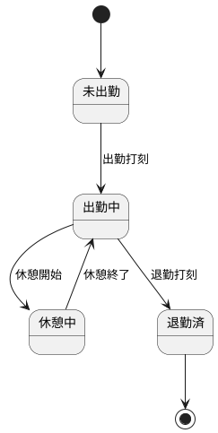
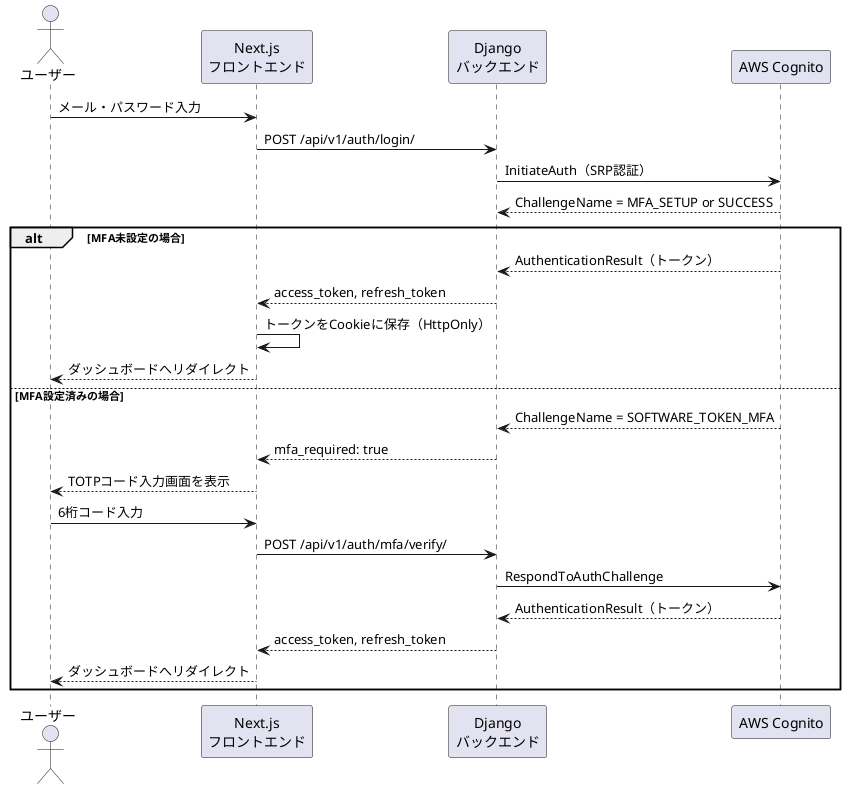
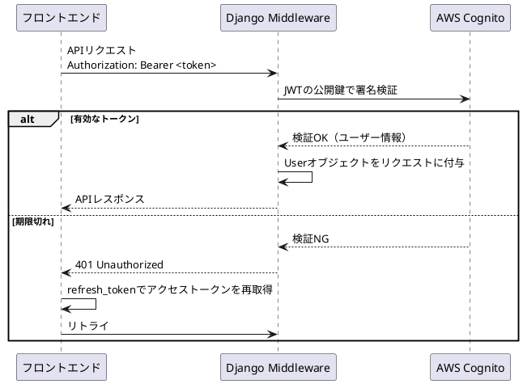
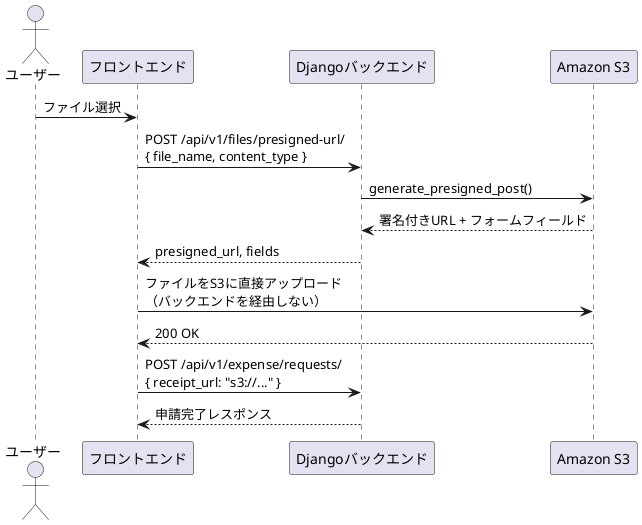
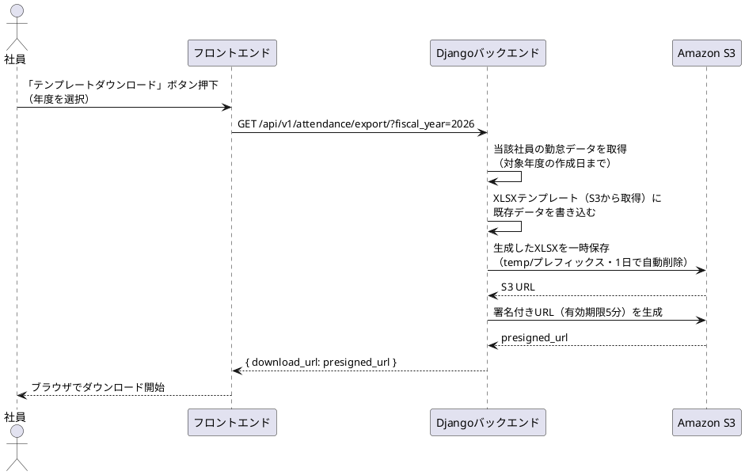

# 人事管理システム（HRM）詳細設計書

**作成日**: 2026-04-09  
**更新日**: 2026-11-19（v1.1: [7章](#7-運用強化機能の詳細設計v11)を追加）  
**バージョン**: 1.1

---

## 目次

1. [DB詳細設計](#1-db詳細設計)
2. [API詳細設計](#2-api詳細設計)
3. [画面詳細設計](#3-画面詳細設計)
4. [認証フロー](#4-認証フロー)
5. [ファイル操作フロー](#5-ファイル操作フロー)
6. [ビジネスロジック詳細](#6-ビジネスロジック詳細)
7. [運用強化機能の詳細設計（v1.1）](#7-運用強化機能の詳細設計v11)

---

## 1. DB詳細設計

### 1.1 ER図

```plantuml
@startuml
skinparam linetype ortho

entity "User\nユーザー" as user {
  * id : UUID <<PK>>
  --
  * email : VARCHAR(255) <<UNIQUE>>
  * cognito_sub : VARCHAR(255) <<UNIQUE>>
  * role : ENUM
  * is_active : BOOLEAN
  created_at : TIMESTAMP
  updated_at : TIMESTAMP
}

entity "Employee\n社員情報" as employee {
  * id : UUID <<PK>>
  --
  * user_id : UUID <<FK>>
  * employee_number : VARCHAR(20) <<UNIQUE>>
  * last_name : VARCHAR(50)
  * first_name : VARCHAR(50)
  * last_name_kana : VARCHAR(50)
  * first_name_kana : VARCHAR(50)
  * birth_date : DATE
  * gender : ENUM
  * hire_date : DATE
  retire_date : DATE
  * department : VARCHAR(100)
  * position : VARCHAR(100)
  * grade : INTEGER
  * employment_type : ENUM
  phone : VARCHAR(20)
  personal_email : VARCHAR(255)
  created_at : TIMESTAMP
  updated_at : TIMESTAMP
}

entity "EmployeeManager\n上司部下関係" as emp_manager {
  * employee_id : UUID <<FK>>
  * manager_id : UUID <<FK>>
}

entity "EmergencyContact\n緊急連絡先" as emergency {
  * id : UUID <<PK>>
  --
  * employee_id : UUID <<FK>>
  * name : VARCHAR(100)
  * relationship : VARCHAR(50)
  * phone : VARCHAR(20)
  sort_order : INTEGER
}

entity "FamilyMember\n家族構成" as family {
  * id : UUID <<PK>>
  --
  * employee_id : UUID <<FK>>
  * name : VARCHAR(100)
  * relationship : ENUM
  * birth_date : DATE
  * is_dependent : BOOLEAN
}

entity "Project\nプロジェクト" as project {
  * id : UUID <<PK>>
  --
  * code : VARCHAR(50) <<UNIQUE>>
  * name : VARCHAR(200)
  * manager_id : UUID <<FK>>
  * is_active : BOOLEAN
  start_date : DATE
  end_date : DATE
  created_at : TIMESTAMP
}

entity "AttendanceRecord\n勤怠記録" as attendance {
  * id : UUID <<PK>>
  --
  * employee_id : UUID <<FK>>
  project_id : UUID <<FK>>
  * date : DATE
  clock_in : TIME
  clock_out : TIME
  break_minutes : INTEGER
  * status : ENUM
  note : TEXT
  created_at : TIMESTAMP
  updated_at : TIMESTAMP
}

entity "AttendanceModRequest\n打刻修正申請" as att_mod {
  * id : UUID <<PK>>
  --
  * attendance_id : UUID <<FK>>
  * applicant_id : UUID <<FK>>
  approver_id : UUID <<FK>>
  * requested_clock_in : TIME
  * requested_clock_out : TIME
  reason : TEXT
  * status : ENUM
  approved_at : TIMESTAMP
  created_at : TIMESTAMP
}

entity "LeaveRequest\n休暇申請" as leave {
  * id : UUID <<PK>>
  --
  * employee_id : UUID <<FK>>
  approver_id : UUID <<FK>>
  * leave_type : ENUM
  * start_date : DATE
  * end_date : DATE
  * days : DECIMAL(4,1)
  reason : TEXT
  * status : ENUM
  approved_at : TIMESTAMP
  created_at : TIMESTAMP
}

entity "LeaveBalance\n有給残日数" as leave_balance {
  * id : UUID <<PK>>
  --
  * employee_id : UUID <<FK>>
  * fiscal_year : INTEGER
  * granted_days : DECIMAL(4,1)
  * used_days : DECIMAL(4,1)
  * carried_days : DECIMAL(4,1)
}

entity "MBOGoal\nMBO目標" as mbo_goal {
  * id : UUID <<PK>>
  --
  * employee_id : UUID <<FK>>
  * year : INTEGER
  * period : ENUM
  * title : VARCHAR(200)
  target_level : TEXT
  * weight : INTEGER
  self_score : DECIMAL(3,1)
  manager_score : DECIMAL(3,1)
  * status : ENUM
  created_at : TIMESTAMP
  updated_at : TIMESTAMP
}

entity "MBOReport\nMBO月間報告" as mbo_report {
  * id : UUID <<PK>>
  --
  * goal_id : UUID <<FK>>
  * month : DATE
  action_content : TEXT
  result : TEXT
  manager_comment : TEXT
  * status : ENUM
  created_at : TIMESTAMP
  updated_at : TIMESTAMP
}

entity "DailyReport\n日報" as daily_report {
  * id : UUID <<PK>>
  --
  * employee_id : UUID <<FK>>
  * report_date : DATE
  content : TEXT
  ai_suggestion : TEXT
  * status : ENUM
  created_at : TIMESTAMP
  updated_at : TIMESTAMP
}

entity "Skill\nスキル" as skill {
  * id : UUID <<PK>>
  --
  * employee_id : UUID <<FK>>
  * skill_name : VARCHAR(100)
  * category : ENUM
  * level : INTEGER
  certified_date : DATE
  expiry_date : DATE
  note : TEXT
}

entity "SalaryGrade\n給与等級マスタ" as salary_grade {
  * id : UUID <<PK>>
  --
  * grade : INTEGER <<UNIQUE>>
  * base_salary : DECIMAL(10,0)
  valid_from : DATE
  valid_to : DATE
}

entity "Allowance\n手当マスタ" as allowance {
  * id : UUID <<PK>>
  --
  * name : VARCHAR(100)
  * allowance_type : ENUM
  * amount : DECIMAL(10,0)
  * is_active : BOOLEAN
}

entity "EmployeeAllowance\n社員手当" as emp_allowance {
  * id : UUID <<PK>>
  --
  * employee_id : UUID <<FK>>
  * allowance_id : UUID <<FK>>
  amount : DECIMAL(10,0)
  valid_from : DATE
  valid_to : DATE
}

entity "Payslip\n給与明細" as payslip {
  * id : UUID <<PK>>
  --
  * employee_id : UUID <<FK>>
  * year : INTEGER
  * month : INTEGER
  * base_salary : DECIMAL(10,0)
  * total_allowances : DECIMAL(10,0)
  * overtime_pay : DECIMAL(10,0)
  * gross_salary : DECIMAL(10,0)
  * health_insurance : DECIMAL(10,0)
  * pension : DECIMAL(10,0)
  * employment_insurance : DECIMAL(10,0)
  * income_tax : DECIMAL(10,0)
  * resident_tax : DECIMAL(10,0)
  * total_deductions : DECIMAL(10,0)
  * net_salary : DECIMAL(10,0)
  * status : ENUM
  payslip_url : VARCHAR(500)
  created_at : TIMESTAMP
}

entity "AccountItem\n勘定科目" as account_item {
  * id : UUID <<PK>>
  --
  * code : VARCHAR(20) <<UNIQUE>>
  * name : VARCHAR(100)
  * category : ENUM
  * is_active : BOOLEAN
}

entity "ExpenseRequest\n経費申請" as expense {
  * id : UUID <<PK>>
  --
  * applicant_id : UUID <<FK>>
  approver_id : UUID <<FK>>
  * account_item_id : UUID <<FK>>
  * expense_type : ENUM
  * amount : DECIMAL(10,0)
  * expense_date : DATE
  description : TEXT
  receipt_url : VARCHAR(500)
  * status : ENUM
  approved_at : TIMESTAMP
  created_at : TIMESTAMP
}

entity "Notification\n通知" as notification {
  * id : UUID <<PK>>
  --
  * user_id : UUID <<FK>>
  * type : ENUM
  * title : VARCHAR(200)
  * message : TEXT
  related_url : VARCHAR(500)
  * is_read : BOOLEAN
  created_at : TIMESTAMP
}

' リレーション
user ||--|| employee
employee ||--o{ emp_manager : "employee_id"
employee ||--o{ emp_manager : "manager_id"
employee ||--o{ emergency
employee ||--o{ family
employee ||--o{ attendance
employee ||--o{ leave
employee ||--o{ leave_balance
employee ||--o{ mbo_goal
employee ||--o{ daily_report
employee ||--o{ skill
employee ||--o{ payslip
employee ||--o{ emp_allowance
employee ||--o{ expense : "applicant"
project ||--o{ attendance
attendance ||--o| att_mod
mbo_goal ||--o{ mbo_report
allowance ||--o{ emp_allowance
account_item ||--o{ expense
user ||--o{ notification

@enduml
```



---

### 1.2 テーブル定義詳細

#### User（ユーザー）
| カラム | 型 | 制約 | 説明 |
|---|---|---|---|
| id | UUID | PK | 主キー（自動生成） |
| email | VARCHAR(255) | NOT NULL, UNIQUE | ログインID |
| cognito_sub | VARCHAR(255) | NOT NULL, UNIQUE | CognitoのユーザーID |
| role | ENUM | NOT NULL | `employee` / `manager` / `hr` / `admin` |
| is_active | BOOLEAN | NOT NULL, DEFAULT TRUE | 有効フラグ |
| created_at | TIMESTAMP | NOT NULL | 作成日時（UTC） |
| updated_at | TIMESTAMP | NOT NULL | 更新日時（UTC） |

#### AttendanceRecord（勤怠記録）
| カラム | 型 | 制約 | 説明 |
|---|---|---|---|
| status | ENUM | NOT NULL | `draft`（下書き）/ `confirmed`（確定）/ `modified`（修正済） |
| break_minutes | INTEGER | DEFAULT 60 | 休憩時間（分） |

> **複合ユニーク制約**: `(employee_id, date)` ← 同じ社員が同じ日に2件登録不可

#### MBOGoal（MBO目標）
| カラム | 型 | 制約 | 説明 |
|---|---|---|---|
| period | ENUM | NOT NULL | `first_half`（上期）/ `second_half`（下期） |
| weight | INTEGER | DEFAULT 100 | ウェイト合計が100になるよう管理 |
| status | ENUM | NOT NULL | `draft` / `submitted` / `approved` / `evaluated` |

---

## 2. API詳細設計

### 2.1 共通仕様

- **ベースURL**: `/api/v1/`
- **認証**: `Authorization: Bearer <JWT_ACCESS_TOKEN>`
- **Content-Type**: `application/json`（ファイルアップロードは `multipart/form-data`）
- **ページネーション**: `?page=1&page_size=20`
- **日時フォーマット**: ISO 8601（`2026-04-09T09:00:00+09:00`）

#### エラーレスポンス共通形式
```json
{
  "error": {
    "code": "VALIDATION_ERROR",
    "message": "入力値が不正です",
    "details": {
      "email": ["有効なメールアドレスを入力してください"]
    }
  }
}
```

#### エラーコード一覧
| HTTPステータス | コード | 説明 |
|---|---|---|
| 400 | `VALIDATION_ERROR` | 入力値エラー |
| 401 | `UNAUTHORIZED` | 認証トークンなし・期限切れ |
| 403 | `FORBIDDEN` | 権限不足 |
| 404 | `NOT_FOUND` | リソースが存在しない |
| 409 | `CONFLICT` | 重複データ |
| 500 | `INTERNAL_ERROR` | サーバー内部エラー |

---

### 2.2 認証 API

#### POST `/api/v1/auth/login/`
Cognitoで認証し、JWT（アクセストークン＋リフレッシュトークン）を返す。

**リクエスト**
```json
{
  "email": "user@example.com",
  "password": "Password123!"
}
```
**レスポンス** `200 OK`
```json
{
  "access_token": "eyJhbGci...",
  "refresh_token": "eyJhbGci...",
  "expires_in": 3600,
  "user": {
    "id": "uuid",
    "email": "user@example.com",
    "role": "employee",
    "full_name": "山田 太郎"
  }
}
```

#### POST `/api/v1/auth/refresh/`
リフレッシュトークンで新しいアクセストークンを取得。

#### POST `/api/v1/auth/logout/`
リフレッシュトークンを無効化。

#### POST `/api/v1/auth/password/reset-request/`
パスワードリセットメールを送信。

#### POST `/api/v1/auth/mfa/setup/`
TOTP（ワンタイムパスワード）のQRコードを取得。

---

### 2.3 社員情報 API

#### GET `/api/v1/employees/`
社員一覧取得。人事担当・管理職のみアクセス可。

**クエリパラメータ**
| パラメータ | 型 | 説明 |
|---|---|---|
| `department` | string | 部署でフィルタ |
| `is_active` | boolean | 在籍中のみ: `true` |
| `search` | string | 氏名・社員番号で検索 |

**レスポンス** `200 OK`
```json
{
  "count": 50,
  "next": "/api/v1/employees/?page=2",
  "results": [
    {
      "id": "uuid",
      "employee_number": "E001",
      "full_name": "山田 太郎",
      "department": "開発部",
      "position": "エンジニア",
      "grade": 3,
      "is_active": true
    }
  ]
}
```

#### GET `/api/v1/employees/{id}/`
社員詳細取得。本人と人事担当・管理職がアクセス可。

#### PATCH `/api/v1/employees/{id}/`
社員情報更新。人事担当・管理者のみ。

#### GET `/api/v1/employees/{id}/organization/`
組織図データ（上司・部下一覧）を取得。

---

### 2.4 出退勤 API

#### POST `/api/v1/attendance/clock-in/`
出勤打刻。

**リクエスト**
```json
{
  "project_id": "uuid",
  "note": "テスト対応"
}
```
**レスポンス** `201 Created`
```json
{
  "id": "uuid",
  "date": "2026-04-09",
  "clock_in": "09:00:00",
  "status": "draft"
}
```

#### POST `/api/v1/attendance/clock-out/`
退勤打刻。当日のdraft記録を更新。

**リクエスト**
```json
{
  "break_minutes": 60
}
```

#### GET `/api/v1/attendance/`
勤怠一覧取得。

**クエリパラメータ**
| パラメータ | 型 | 説明 |
|---|---|---|
| `year_month` | string | 例: `2026-04` |
| `employee_id` | UUID | 管理職・人事担当のみ指定可 |

#### POST `/api/v1/attendance/modification-requests/`
打刻修正申請。

**リクエスト**
```json
{
  "attendance_id": "uuid",
  "requested_clock_in": "09:00:00",
  "requested_clock_out": "18:30:00",
  "reason": "打刻忘れのため"
}
```

#### PATCH `/api/v1/attendance/modification-requests/{id}/approve/`
修正申請を承認（管理職のみ）。

#### GET `/api/v1/attendance/summary/`
月次集計データ取得。

**レスポンス**
```json
{
  "year_month": "2026-04",
  "total_work_days": 20,
  "total_work_hours": "160:00",
  "total_overtime_hours": "8:30",
  "late_night_hours": "1:00",
  "holiday_work_hours": "0:00",
  "overtime_alert": false
}
```

#### GET `/api/v1/attendance/export/`
勤怠データをXLSXでエクスポート（年度単位、作成日までのデータ）。

**クエリパラメータ**: `?fiscal_year=2026`

#### POST `/api/v1/attendance/import/`
XLSXテンプレートをアップロードして一括更新。

**リクエスト**: `multipart/form-data`
| フィールド | 型 | 説明 |
|---|---|---|
| `file` | File | XLSXファイル |
| `fiscal_year` | integer | 年度 |

---

### 2.5 有給・休暇 API

#### GET `/api/v1/leave/balance/`
有給残日数取得。

**レスポンス**
```json
{
  "fiscal_year": 2026,
  "granted_days": 20.0,
  "used_days": 5.0,
  "carried_days": 10.0,
  "remaining_days": 25.0
}
```

#### POST `/api/v1/leave/requests/`
休暇申請。

**リクエスト**
```json
{
  "leave_type": "annual",
  "start_date": "2026-04-20",
  "end_date": "2026-04-21",
  "reason": "私用のため"
}
```

#### PATCH `/api/v1/leave/requests/{id}/approve/`
承認（管理職のみ）。

---

### 2.6 MBO API

#### GET `/api/v1/mbo/goals/`
MBO目標一覧取得。

**クエリパラメータ**: `?year=2026&period=first_half`

#### POST `/api/v1/mbo/goals/`
目標登録。

**リクエスト**
```json
{
  "year": 2026,
  "period": "first_half",
  "title": "新機能リリース3件達成",
  "target_level": "月1件以上のリリースを継続する",
  "weight": 40
}
```

#### POST `/api/v1/mbo/goals/{id}/submit/`
目標を上司に提出。

#### POST `/api/v1/mbo/reports/`
月間報告の登録・更新。

**リクエスト**
```json
{
  "goal_id": "uuid",
  "month": "2026-04-01",
  "action_content": "APIの設計・実装を行った",
  "result": "予定通り1件リリース完了"
}
```

#### POST `/api/v1/mbo/reports/{id}/ai-suggest/`
AI（Bedrock）による文章改善提案を取得。

**レスポンス**
```json
{
  "suggestions": {
    "action_content": "「APIの設計・実装を行った」→ 具体的な成果数値を追記することを推奨します。例：「REST API 5エンドポイントの設計・実装を完了し、単体テストカバレッジ80%を達成した」",
    "result": "定量的な指標（件数・時間・数値）を含めると評価しやすくなります"
  }
}
```

#### GET `/api/v1/mbo/goals/{id}/export/`
PDF・XLSXでエクスポート。`?format=pdf` または `?format=xlsx`

---

### 2.7 給与 API

#### GET `/api/v1/salary/payslips/`
給与明細一覧（本人のみ）。

#### GET `/api/v1/salary/payslips/{id}/download/`
給与明細PDFをダウンロード（S3の署名付きURLを返す）。

#### POST `/api/v1/salary/calculate/`
給与計算実行（人事担当のみ）。

**リクエスト**
```json
{
  "year": 2026,
  "month": 4,
  "employee_ids": ["uuid1", "uuid2"]
}
```

#### GET `/api/v1/salary/grades/`
等級別基本給マスタ一覧。

---

### 2.8 経費申請 API

#### POST `/api/v1/expense/requests/`
経費申請。

**リクエスト** `multipart/form-data`
| フィールド | 型 | 説明 |
|---|---|---|
| `expense_type` | string | `transportation` / `general` |
| `account_item_id` | UUID | 勘定科目 |
| `amount` | integer | 金額（円） |
| `expense_date` | date | 費用発生日 |
| `description` | string | 内容説明 |
| `receipt` | File | 領収書画像 |

#### GET `/api/v1/expense/account-items/export/`
勘定科目一覧をCSVでエクスポート。

#### POST `/api/v1/expense/account-items/import/`
CSVで勘定科目を一括更新（システム管理者のみ）。

---

### 2.9 スキル API

#### GET `/api/v1/skills/`
スキル一覧。`?employee_id=uuid`

#### POST `/api/v1/skills/`
スキル登録。

**リクエスト**
```json
{
  "skill_name": "Python",
  "category": "language",
  "level": 4,
  "certified_date": "2025-06-01",
  "expiry_date": null
}
```

---

### 2.10 通知 API

#### GET `/api/v1/notifications/`
通知一覧（未読件数付き）。

#### PATCH `/api/v1/notifications/{id}/read/`
既読にする。

#### PATCH `/api/v1/notifications/read-all/`
全て既読にする。

---

## 3. 画面詳細設計

### 3.1 ダッシュボード（社員向け）

**URL**: `/`

**表示コンテンツ**
| セクション | 内容 |
|---|---|
| 打刻ウィジェット | 出勤・退勤ボタン、現在の状態、今日の勤務時間 |
| 今月の勤務サマリ | 労働時間・残業時間・有給残日数 |
| TODOリスト | 未承認申請・未提出MBO報告・未読通知 |
| MBO進捗 | 今期の目標達成率（プログレスバー） |

---

### 3.2 打刻画面

**URL**: `/attendance`

**状態遷移**



**入力項目**
- プロジェクト選択（必須）：プルダウン
- 備考（任意）：テキスト入力

**勤怠カレンダー**
- 月次表示（前月・翌月ナビゲーション）
- 凡例：通常出勤 / 有給 / 欠勤 / 休日
- 日付クリックで詳細表示

---

### 3.3 打刻修正申請画面

**URL**: `/attendance/modification-requests/new`

**入力項目**
| 項目 | 型 | 必須 | バリデーション |
|---|---|---|---|
| 対象日付 | date picker | ○ | 過去30日以内 |
| 修正後 出勤時刻 | time picker | ○ | 退勤より前 |
| 修正後 退勤時刻 | time picker | ○ | 出勤より後 |
| 理由 | textarea | ○ | 最大500文字 |

---

### 3.4 MBO目標設定画面

**URL**: `/mbo/goals/new`

**入力項目**
| 項目 | 型 | 必須 | バリデーション |
|---|---|---|---|
| 年度・期 | select | ○ | — |
| 目標タイトル | text | ○ | 最大200文字 |
| 達成水準 | textarea | ○ | — |
| ウェイト（%） | number | ○ | 全目標合計が100になること |

**AIアシスト機能**
- 「AI添削」ボタン押下でBedrockを呼び出し
- 改善提案をモーダルで表示
- 「適用」ボタンで本文に反映

---

### 3.5 給与明細画面

**URL**: `/salary/payslips`

**表示レイアウト（明細詳細）**
```
┌──────────────────────────────┐
│  2026年4月分 給与明細          │
├──────────────┬───────────────┤
│ 【支給】      │               │
│ 基本給       │  ¥300,000     │
│ 住宅手当     │   ¥20,000     │
│ 残業手当     │   ¥15,000     │
│ 支給合計     │  ¥335,000     │
├──────────────┼───────────────┤
│ 【控除】      │               │
│ 健康保険料   │   ¥16,000     │
│ 厚生年金     │   ¥29,000     │
│ 雇用保険     │    ¥1,000     │
│ 所得税       │   ¥10,000     │
│ 住民税       │   ¥15,000     │
│ 控除合計     │   ¥71,000     │
├──────────────┼───────────────┤
│ 【差引支給額】 │  ¥264,000     │
└──────────────┴───────────────┘
```

---

## 4. 認証フロー

### 4.1 ログインフロー



### 4.2 API認証フロー（リクエストごと）



---

## 5. ファイル操作フロー

### 5.1 ファイルアップロードフロー（S3署名付きURL）



> **S3直接アップロードの利点**: 大きなファイルをDjangoサーバーに転送しないため、サーバー負荷が下がりコストも削減できます。

### 5.2 テンプレートXLSXダウンロードフロー



### 5.3 勘定科目CSVフロー

**エクスポート**
1. `GET /api/v1/expense/account-items/export/` を呼び出す
2. DjangoがDBから全勘定科目を取得
3. CSV形式に変換してStreamingResponseで返す

**インポート**
1. CSVファイルを選択してアップロード
2. Djangoでバリデーション（コードの重複・必須項目チェック）
3. エラーがあれば行番号付きでエラー一覧を返す
4. 問題なければDBを一括更新（upsert：既存は上書き、新規は追加）

**CSVフォーマット**
```csv
code,name,category,is_active
1001,旅費交通費,expense,true
1002,消耗品費,expense,true
2001,接待交際費,entertainment,true
```

---

## 6. ビジネスロジック詳細

### 6.1 残業時間計算ルール

```
実労働時間 = (退勤時刻 - 出勤時刻) - 休憩時間

[残業種別]
通常残業  : 実労働時間 > 8時間 の超過分（25%割増）
深夜残業  : 22:00〜翌5:00 の労働時間（25%割増 ※通常残業と重複時は合算50%）
休日労働  : 法定休日（日曜）の労働（35%割増）
```

### 6.2 36協定アラートルール

```
月間残業時間 >= 40時間 → 警告通知（本人・管理職・人事担当）
月間残業時間 >= 80時間 → 緊急通知（同上）
```

### 6.3 給与計算ロジック

```
【支給額計算】
gross_salary = base_salary
             + Σ(allowances)
             + overtime_pay（残業代）

【社会保険料計算】（標準報酬月額から）
health_insurance     = 標準報酬月額 × 健康保険料率（都道府県別） / 2
pension              = 標準報酬月額 × 0.183 / 2  ← 厚生年金（折半）
employment_insurance = gross_salary × 0.006        ← 雇用保険

【所得税計算】
課税所得 = gross_salary - 社会保険料合計 - 給与所得控除
income_tax = 課税所得 に対する源泉徴収税額表を参照

【差引支給額】
net_salary = gross_salary - health_insurance - pension
           - employment_insurance - income_tax - resident_tax
```

### 6.4 有給付与ロジック

| 勤続年数 | 付与日数 |
|---|---|
| 6ヶ月 | 10日 |
| 1年6ヶ月 | 11日 |
| 2年6ヶ月 | 12日 |
| 3年6ヶ月 | 14日 |
| 4年6ヶ月 | 16日 |
| 5年6ヶ月 | 18日 |
| 6年6ヶ月以上 | 20日 |

- 繰越は最大**20日**まで
- 付与日 = 入社日から6ヶ月後、以降1年ごと
- 定期実行基盤（`scheduler` アプリ）のジョブ `leave.grant_annual_leave` で毎朝処理（v1.1 で celery-beat 案から変更。[7.1](#71-定期実行基盤scheduler) 参照）

### 6.5 MBOウェイト合計チェック

- 同一社員・同一年・同一期の全目標のweight合計 = **100** であること
- 提出時にバリデーション。合計が100でない場合は `400 VALIDATION_ERROR`

### 6.6 AI補助機能（Bedrock呼び出し）

**プロンプト設計（MBO月間報告の添削）**
```
あなたは人事評価の専門家です。
以下のMBO月間報告の文章を評価し、改善提案を行ってください。

【評価観点】
1. 具体性：数値・件数・期日が含まれているか
2. 結果明確性：行動の結果・成果が明確か
3. 目標との紐付き：目標に対する貢献が分かるか

【入力文章】
行動内容: {action_content}
結果・考察: {result}

【出力形式（JSON）】
{
  "action_content_suggestion": "改善提案文",
  "result_suggestion": "改善提案文",
  "overall_score": 1-5,
  "feedback": "総合コメント"
}
```

**使用モデル**: `anthropic.claude-sonnet-4-5-20250929-v1:0`

---

## 7. 運用強化機能の詳細設計（v1.1）

### 7.0 共通方針

- 新規モデルは既存と同じく `SoftDeleteModel` を継承し、UUID 主キーとする（実行ログの `JobRun` のみ `AuditLog` と同様にログ扱いで継承しない）。
- 通知は既存の `Notification.send()` を使う。v1.1 で通知種別を追加する：
  `leave_obligation`（年5日取得義務）/ `approval_reminder`（承認リマインド）/ `work_interval`（勤務間インターバル）/ `health_checkup`（健康診断）/ `one_on_one`（1on1）/ `pulse_survey`（パルスサーベイ）
- 追加の環境変数（すべて任意。括弧内は既定値）：

| 変数 | 説明 |
|---|---|
| `SCHEDULER_RUN_AT` (`06:00`) | 定期ジョブの実行時刻（Asia/Tokyo） |
| `APPROVAL_REMIND_DAYS` (`3`) | 承認待ちを再通知する間隔（日） |
| `WORK_INTERVAL_MINUTES` (`660`) | 勤務間インターバルの基準（分）。11時間 |
| `COMPENSATORY_LEAVE_VALID_DAYS` (`90`) | 休日出勤日から代休を取得できる期限（日） |
| `PULSE_MIN_GROUP_SIZE` (`5`) | パルスサーベイで集計を表示する最小人数 |
| `FRONTEND_URL` (`http://localhost:3000`) | Webhook のメッセージに載せる画面 URL の起点 |
| `WEBHOOK_TIMEOUT_SECONDS` (`5`) | Webhook 送信のタイムアウト |

### 7.1 定期実行基盤（scheduler）

**構成**
```
apps/scheduler/
  registry.py   … @register_job(name, description, order) でジョブを登録
  runner.py     … run_due_jobs(run_date, only=None, force=False)
  models.py     … JobRun（実行履歴）
  management/commands/run_jobs.py       … 1回だけ実行（cron / EventBridge から起動）
  management/commands/run_scheduler.py  … 常駐して毎日 SCHEDULER_RUN_AT に run_jobs 相当を実行
各アプリの jobs.py … ジョブ本体。scheduler の AppConfig.ready() で autodiscover する
```

**JobRun**

| カラム | 型 | 説明 |
|---|---|---|
| id | UUID | PK |
| job_name | VARCHAR(100) | 例 `leave.grant_annual_leave` |
| run_date | DATE | 対象日（ジョブ内の「今日」） |
| status | VARCHAR(20) | `running` / `success` / `failed` |
| result | JSONB | ジョブの戻り値（件数など） |
| error | TEXT | 失敗時のスタックトレース |
| started_at / finished_at | TIMESTAMP | |

**実行ルール**
- 同じ `job_name` × `run_date` で `success` の記録があればスキップする（`--force` で再実行）。
- 1つのジョブが失敗しても後続のジョブは実行する。失敗はシステム管理者に `system` 通知する。
- ジョブは `order` 昇順で実行する（年度繰越 → 有給付与 の順序を保証するため）。

**API**

| メソッド | パス | 権限 | 説明 |
|---|---|---|---|
| GET | `/api/v1/scheduler/jobs/` | 人事以上 | 登録ジョブ一覧と最終実行結果 |
| GET | `/api/v1/scheduler/runs/?job_name=` | 人事以上 | 実行履歴（新しい順） |
| POST | `/api/v1/scheduler/jobs/{job_name}/run/` | 管理者 | 手動実行（`{"date": "YYYY-MM-DD", "force": true}` 任意） |

### 7.2 有給の自動付与・年5日取得義務・代休

**LeaveGrant（有給付与履歴）**

| カラム | 型 | 説明 |
|---|---|---|
| employee_id | FK | |
| grant_date | DATE | 付与日（employee と複合ユニーク） |
| days | DECIMAL(4,1) | 付与日数 |
| expires_on | DATE | 時効（付与日から2年後の前日） |
| source | VARCHAR(10) | `auto`（ジョブ）/ `manual`（人事が登録） |
| note | TEXT | |

**自動付与（`leave.grant_annual_leave`）**
- 対象：雇用形態が正社員・契約社員で、入社日があり、退職していない社員。
  パート（比例付与）と派遣社員は対象外とし、必要に応じて人事が手動付与する。
- 付与日：入社日の6ヶ月後、以降1年ごと。付与日数は [6.4](#64-有給付与ロジック) の表に従う。
- 出勤率8割の要件は判定しない（勤怠データが揃っていない期間があるため）。対象外の社員は人事が付与履歴を削除する。
- 実行日時点の「直近の付与日」に付与履歴がなければ付与する（ジョブが数日止まっても取りこぼさない）。
- 付与時は付与日の属する年度の `LeaveBalance.granted_days` に加算し、本人に通知する。

**年度繰越（`leave.rollover_fiscal_year`）**
- 前年度の残高がある社員について、今年度の残高を作成（または取得）する。
- `rollover_done = false` の場合のみ：`carried_days = min(前年度残日数, 前年度付与日数, 20)` を設定し、`rollover_done = true` にする。
  前年度付与分のみが繰り越せる（2年の時効）ため、前年度付与日数を上限とする。
- 既に `carried_days` が手入力されている（0 以外）場合は上書きせず、処理済みにだけする。

**年5日取得義務（`leave.check_five_day_obligation`）**
- 対象：付与日数が10日以上の付与履歴のうち、基準期間（付与日〜1年後の前日）の途中にあるもの。
- 取得日数：基準期間内に開始する承認済みの有給（`annual`）申請の日数合計（半日 0.5 日を含む）。
- 取得日数 < 5 日の場合、期限までの残り日数が 90 / 60 / 30 / 14 / 7 日の日に通知する。
  - 本人と上司：全タイミング
  - 人事・労務：30日前と7日前

**代休**
- `LeaveRequest.leave_type` に `compensatory`（代休）を追加し、`holiday_work_id`（勤怠記録への FK）を必須にする。
- バリデーション：本人の勤怠記録であること／`day_type` が所定休日または法定休日であること／退勤済みであること／
  同じ休日出勤に紐づく有効な（申請中・承認済の）代休申請がないこと／取得日が休日出勤日の翌日以降かつ `COMPENSATORY_LEAVE_VALID_DAYS` 日以内であること。
- 代休は有給残高を減らさない。

**API**

| メソッド | パス | 権限 | 説明 |
|---|---|---|---|
| GET | `/api/v1/leave/grants/` | 本人（上司以上は `?employee_id=`） | 付与履歴 |
| POST | `/api/v1/leave/grants/` | 人事 | 手動付与（残高にも加算） |
| GET | `/api/v1/leave/grants/obligation/` | 本人 | 自分の年5日の状況 |
| GET | `/api/v1/leave/grants/obligation-summary/` | 管理職・労務・人事 | 全社員の年5日の状況 |
| GET | `/api/v1/attendance/holiday-work/?unused=true` | 本人 | 代休の元にできる休日出勤一覧 |

年5日の状況レスポンス例：
```json
{
  "grant_date": "2026-04-01", "deadline": "2027-03-31", "granted_days": 11.0,
  "taken_days": 2.0, "required_days": 5, "remaining_required": 3.0,
  "days_until_deadline": 132, "status": "ok"
}
```
`status`：5日取得済み → `ok`、未達で期限まで90日超 → `ok`、未達で90日以内 → `warning`、期限超過で未達 → `overdue`。

### 7.3 承認リマインド・代理承認

**ApprovalDelegation（代理承認）**

| カラム | 型 | 説明 |
|---|---|---|
| delegator_id | FK Employee | 委任元（不在になる承認者） |
| delegate_id | FK Employee | 代理人 |
| start_date / end_date | DATE | 有効期間（両端を含む） |
| reason | VARCHAR(200) | 例：夏季休暇 |

- 委任元と代理人は別人であること、`end_date >= start_date` であること。代理の代理（多段委任）は辿らない。
- 登録・削除は委任元本人、または人事。

**対象となる承認**

| 申請 | 承認者 | 代理人が承認できる条件 |
|---|---|---|
| 休暇申請・経費申請・打刻修正申請 | 申請者の上司（`Employee.managers`） | 委任元が申請者の上司である |
| 電子稟議 | 現在のステップの `ApprovalStep.approver` | 委任元がそのステップの承認者である |

- 承認依頼の通知は、承認者に加えて有効な代理人にも「【代理】」を付けて送る。
- 稟議では実際に判断した人を `ApprovalStep.decided_by` に記録する（休暇・経費・打刻修正は従来どおり `approver` に実際の承認者を記録）。
- 代理人が一般社員の場合でも、代理期間中は委任元の部下の申請を一覧・承認できる。

**リマインド（`approval.remind_pending`）**
- 経過日数 = 今日 − 起算日。起算日は、休暇・経費・打刻修正は申請日、稟議は「1つ前のステップの判断日（なければ申請日）」。
- 経過日数が `APPROVAL_REMIND_DAYS` 以上かつその倍数の日に、承認者（＋代理人）へ `approval_reminder` 通知を送る。

**API**

| メソッド | パス | 権限 | 説明 |
|---|---|---|---|
| GET | `/api/v1/approval/delegations/` | 本人（自分が委任元・代理人のもの）／人事は全件 | 代理設定一覧 |
| POST | `/api/v1/approval/delegations/` | 本人（人事は `delegator` 指定可） | 登録 |
| DELETE | `/api/v1/approval/delegations/{id}/` | 委任元・人事 | 削除（論理削除） |

### 7.4 休日出勤・勤務間インターバル・打刻時の位置情報

**AttendanceRecord 追加カラム**

| カラム | 型 | 説明 |
|---|---|---|
| day_type | VARCHAR(20) | `weekday`（平日）/ `non_legal_holiday`（所定休日）/ `legal_holiday`（法定休日）。既定 `weekday` |
| rest_interval_minutes | INT NULL | 前回の退勤から今回の出勤までの分数 |
| clock_in_ip / clock_out_ip | INET NULL | 打刻時の IP（`X-Forwarded-For` の先頭、なければ `REMOTE_ADDR`） |
| clock_in_latitude / clock_in_longitude / clock_out_latitude / clock_out_longitude | DECIMAL(9,6) NULL | 打刻時の位置（ブラウザで許可された場合のみ） |

**日の区分の判定**（出勤打刻時・一括アップロード時に自動設定。上司以上は PATCH で変更可）
- 日曜日 → 法定休日
- 土曜日・国民の祝日（`holidays` ライブラリ）・12/31〜1/3 → 所定休日
- それ以外 → 平日

**時間計算（6.1 を v1.1 で具体化）**

| 区分 | 時間外（`overtime_minutes`） | 休日労働（`holiday_work_minutes`） |
|---|---|---|
| 平日 | 実労働 − 480分（0未満は0） | 0 |
| 所定休日 | 実労働の全時間 | 0 |
| 法定休日 | 0 | 実労働の全時間 |

- 深夜時間（`late_night_minutes`）：出勤〜退勤のうち 0:00〜5:00 と 22:00〜24:00 に重なる分数（休憩控除は行わない概算）。日をまたぐ勤務は扱わない（退勤は当日中の前提）。
- 36協定の集計は `overtime_minutes` を使うため、法定休日労働は月45h・年360hの時間外に含まれない（法令どおり）。
- 給与計算：`時間外手当（深夜・休日）` = 手当マスタの値 ＋ 時給×休日労働時間×1.35 ＋ 時給×深夜時間×0.25（時給 = 基本給 / 160、既存ロジックと同じ）。

**勤務間インターバル**
- 出勤打刻時、直前の勤怠記録（退勤済み）の退勤日時から現在までの分数を `rest_interval_minutes` に保存する。
- `WORK_INTERVAL_MINUTES` 未満なら本人と上司に `work_interval` 通知を送る（打刻自体は止めない）。

**打刻 API の追加パラメータ**（`clock-in` / `clock-out` 共通、すべて任意）
```json
{ "latitude": 35.681236, "longitude": 139.767125 }
```

### 7.5 異動・昇格履歴

**EmploymentHistory**

| カラム | 型 | 説明 |
|---|---|---|
| employee_id | FK | |
| effective_date | DATE | 発令日 |
| change_type | VARCHAR(30) | `transfer`（異動）/ `promotion`（昇格）/ `demotion`（降格）/ `position_change`（役職変更）/ `employment_type_change`（雇用形態変更）/ `other` |
| department_before / department_after | VARCHAR(100) | |
| position_before / position_after | VARCHAR(100) | |
| grade_before / grade_after | INT NULL | |
| employment_type_before / employment_type_after | VARCHAR(20) | |
| note | TEXT | 発令内容・理由 |
| is_applied | BOOL | 社員情報へ反映済みか |
| applied_at | TIMESTAMP NULL | |
| created_by | FK User NULL | |

**記録のされ方**
1. **自動記録**：社員情報の部署・役職・等級・雇用形態が変更・保存されたとき、変更前後を `effective_date = 今日`・`is_applied = true` で記録する。
2. **発令登録**：人事が変更後の値と発令日を登録する。発令日が今日以前ならすぐ反映、未来日なら `is_applied = false` で予約し、`employees.apply_scheduled_changes` が発令日に反映する。反映時は 1 の自動記録を重ねて作らない。

- `change_type` の自動判定の優先順：等級↑ → `promotion`、等級↓ → `demotion`、部署変更 → `transfer`、役職変更 → `position_change`、雇用形態変更 → `employment_type_change`。

**過去時点の再現（`as_of`）**
- 指定日以前に反映された最後の履歴の「変更後」の値を使う。
- 指定日以前の履歴がなく、指定日より後の履歴がある場合は、最初の履歴の「変更前」の値を使う。
- 履歴がない場合は現在の値を使う。入社日が指定日より後の社員と、指定日以前に退職した社員は除外する。

**API**

| メソッド | パス | 権限 | 説明 |
|---|---|---|---|
| GET | `/api/v1/employees/{id}/history/` | 本人・管理職以上 | 履歴一覧（発令日の新しい順） |
| POST | `/api/v1/employees/{id}/history/` | 人事 | 発令登録 |
| GET | `/api/v1/employees/org-chart/?as_of=YYYY-MM-DD` | 管理職以上 | 指定日時点の組織図 |

### 7.6 健康診断の受診管理

**HealthCheckup**

| カラム | 型 | 説明 |
|---|---|---|
| employee_id | FK | |
| fiscal_year | INT | 年度（4月始まり） |
| checkup_type | VARCHAR(20) | `regular`（定期）/ `hiring`（雇入時）/ `special`（特殊）/ `other` |
| scheduled_date | DATE NULL | 受診予定日 |
| checkup_date | DATE NULL | 受診日（NULL = 未受診） |
| institution | VARCHAR(200) | 医療機関 |
| result | VARCHAR(20) | `''`（未判定）/ `a_normal`（異常なし）/ `b_minor`（軽度異常）/ `c_observation`（要経過観察）/ `d_reexam`（要再検査）/ `e_treatment`（要治療） |
| followup_due_date | DATE NULL | 再検査・受診の期限 |
| followup_completed_date | DATE NULL | 再検査・受診の完了日 |
| note | TEXT | |

- 判定が `d_reexam` / `e_treatment` のとき「要フォロー」とする（`followup_required`）。
- 権限：本人は自分の記録を閲覧のみ。登録・編集・全件閲覧は労務・人事・管理者（`User.is_labor` を追加）。上司には開示しない。

**集計（`GET /api/v1/health-checkups/summary/?fiscal_year=`）**
```json
{
  "fiscal_year": 2026, "target_count": 30, "checked_count": 24, "checkup_rate": 80.0,
  "followup_required_count": 5, "followup_pending_count": 2,
  "unchecked": [{"employee_id": "...", "full_name": "...", "department": "..."}]
}
```
対象者 = 在籍中で顧客ロール以外の社員。受診済み = その年度の定期健診の `checkup_date` がある。

**リマインド（`health_checkup.remind_followups`）**
- 要フォローで未完了かつ期限ありの記録について、期限の 14 / 7 / 1 / 0 日前に本人へ通知する。
- 期限超過後は 7 日ごとに本人と労務・人事へ通知する。

**API**：`/api/v1/health-checkups/`（CRUD）、`/api/v1/health-checkups/summary/`

### 7.7 1on1 記録

**OneOnOneMeeting**

| カラム | 型 | 説明 |
|---|---|---|
| manager_id / member_id | FK Employee | 上司・部下（`member.managers` に `manager` が含まれること） |
| scheduled_at | TIMESTAMP | 実施日時 |
| duration_minutes | INT | 既定 30 |
| status | VARCHAR(20) | `scheduled` / `done` / `cancelled` |
| agenda | TEXT | アジェンダ（双方が編集） |
| shared_notes | TEXT | 共有メモ（双方が編集） |
| manager_private_notes | TEXT | 上司だけのメモ（部下には返さない） |
| action_items | JSONB | `[{"text": "...", "owner": "manager" または "member", "done": false}]` |
| ai_summary | TEXT | AI 要約 |

- 閲覧・編集は参加者2名のみ（人事・管理者も他人の1on1は見られない）。
- 作成時に相手へ `one_on_one` 通知、前日に双方へリマインド（`one_on_one.remind_upcoming`）。

**AI 要約（`POST /api/v1/one-on-one/meetings/{id}/ai-summary/`）**
- 入力：アジェンダ、共有メモ、前回の1on1のアクションアイテム。**上司メモは送らない**（共有される要約に混ざらないようにするため）。
- 出力（構造化出力で JSON スキーマを指定）：
  ```json
  { "summary": "要約（300字程度）",
    "action_items": [{"text": "...", "owner": "manager"}],
    "next_agenda": ["次回のアジェンダ案"] }
  ```
- `summary` は `ai_summary` に保存する。アクションアイテムとアジェンダ案は画面で確認してから取り込む。
- 使用モデル：`claude-opus-5-5`（effort `low`）。拒否時に別モデルで再実行するサーバー側フォールバック（`fallbacks: "default"`）を有効にする。

### 7.8 Slack / Teams 通知連携

**WebhookEndpoint（全社向け。管理者が設定）**

| カラム | 型 | 説明 |
|---|---|---|
| name | VARCHAR(100) | 例：労務チャンネル |
| provider | VARCHAR(10) | `slack` / `teams` |
| url | VARCHAR(500) | Incoming Webhook URL |
| notification_types | JSONB | 転送する通知種別（1つ以上必須） |
| is_active | BOOL | |

**個人向け**：`User.personal_webhook_provider` / `personal_webhook_url`。本人宛ての通知をすべて転送する。

**送信ルール**
- `Notification.send()` で通知を作成した後に送信する。送信は別スレッドで行い、失敗してもアプリ内通知の作成は成功させる（失敗はログのみ）。
- 全社 Webhook には `stress_check` と `health_checkup` の通知を送らない（設定でも選べない）。
- URL は https のみ。Slack は `hooks.slack.com`、Teams は `*.webhook.office.com`、`*.logic.azure.com`、`*.powerplatform.com` のみ許可する（SSRF 対策）。
- メッセージ：Slack は `{"text": "*タイトル*\nメッセージ\n<URL|画面を開く>"}`、Teams は Adaptive Card（Workflows の「Webhook 要求を受信したらチャネルに投稿する」形式）。全社向けには宛先の氏名を先頭に付ける。

**API**

| メソッド | パス | 権限 | 説明 |
|---|---|---|---|
| GET/POST | `/api/v1/notifications/webhooks/` | 管理者（GET は人事も可） | 全社 Webhook |
| PATCH/DELETE | `/api/v1/notifications/webhooks/{id}/` | 管理者 | |
| POST | `/api/v1/notifications/webhooks/{id}/test/` | 管理者 | テスト送信 |
| GET/PUT | `/api/v1/notifications/personal-webhook/` | 本人 | 個人 Webhook の取得・設定（空文字で解除） |
| POST | `/api/v1/notifications/personal-webhook/test/` | 本人 | テスト送信 |

### 7.9 スマホ対応（PWA）

- `app/manifest.ts` で Web App Manifest を出力する（`display: standalone`、ショートカット「打刻」→ `/clock`）。
- `public/sw.js`：画面遷移はネットワーク優先、オフライン時は `/offline.html` を表示する。API 応答はキャッシュしない（勤怠・給与データを端末に残さないため）。
- `/clock`：サイドバーなしの全画面打刻ページ。出勤・退勤ボタン、今日の打刻時刻、位置情報の記録有無を表示する。
- 打刻時は `navigator.geolocation.getCurrentPosition`（タイムアウト5秒）で位置を取得し、拒否・失敗時は位置なしで打刻する。
- メインレイアウトは `md` 未満でサイドバーを隠し、ヘッダーのメニューボタンで開閉する。

### 7.10 パルスサーベイ

**テーブル**

| テーブル | 主なカラム |
|---|---|
| PulseSurvey | title, description, start_date, end_date, is_published, is_anonymous（既定 true）, created_by |
| PulseQuestion | survey_id, order, text, kind（`scale5`: 1〜5 / `enps`: 0〜10 / `text`: 自由記述）, is_required |
| PulseParticipation | survey_id, employee_id, submitted_at（survey と employee で複合ユニーク。二重回答防止） |
| PulseResponse | survey_id, answers（`{question_id: 値}`）, department（回答時点の部署）, employee_id（記名式のときのみ）, submitted_at |

- 匿名の場合、回答（PulseResponse）に社員 ID を持たない。回答済みかどうかは PulseParticipation だけで判定する。
- 質問を指定せずに作成した場合は既定の5問（eNPS・仕事の満足度・上司のサポート・チームの雰囲気・自由記述）を作る。
- 公開時に顧客以外の全社員へ通知し、回答期限の2日前に未回答者へリマインドする。

**集計（`GET /api/v1/pulse/surveys/{id}/results/`、人事のみ）**
- 回答数が `PULSE_MIN_GROUP_SIZE` 未満なら集計を返さない（`"insufficient": true`）。
- 質問ごと：`scale5` は平均と1〜5の分布、`enps` は eNPS（推奨者 9〜10 の割合 − 批判者 0〜6 の割合）と分布、`text` は回答の一覧（順序をシャッフル）。
- 部署別：回答数が `PULSE_MIN_GROUP_SIZE` 以上の部署のみ、数値質問の平均を返す。

**API**

| メソッド | パス | 権限 | 説明 |
|---|---|---|---|
| GET | `/api/v1/pulse/surveys/` | 全員（人事は未公開も含む） | 一覧（`has_answered` 付き） |
| POST/PATCH/DELETE | `/api/v1/pulse/surveys/` | 人事 | 作成・編集（公開後は質問を変更不可） |
| POST | `/api/v1/pulse/surveys/{id}/publish/` | 人事 | 公開・通知 |
| POST | `/api/v1/pulse/surveys/{id}/answer/` | 全員 | 回答（期間内・1回のみ） |
| GET | `/api/v1/pulse/surveys/{id}/results/` | 人事 | 集計 |
